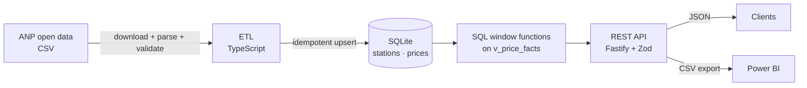

# ⛽ Fuel Prices Analytics API


An **ETL pipeline + typed REST API** over Brazil's official fuel price survey (**ANP open data**), with analytical SQL underneath and **Power BI** queries on top.

The ANP publishes weekly prices collected at gas stations across all 27 states. This project loads those files into a relational database, exposes the questions people actually ask (*Which state is cheapest? How is the price trending? Is ethanol worth it here?*) through an API, and feeds a BI report.



## Verified on real data

Loaded the official ANP files for **31 Aug – 25 Sep 2026** (gasoline/ethanol + diesel/CNG):

| | |
|:--|:--|
| Rows read | **67,204** across 27 states, 5,739 stations, 6 products |
| Rejected | **0** |
| Load time | ~1.5 s, single transaction |
| Re-load of the same file | 0 new rows (idempotent) |
| Cross-check | Summary, median, per-state ranking and ethanol ratios **match an independent pandas calculation** on the raw CSV |

Example from that dataset:

```bash
curl "localhost:3000/api/v1/prices/summary?product=GASOLINA"
```
```json
{ "product": "GASOLINA", "observations": 17533, "stations": 5679,
  "min": 5.44, "avg": 6.558, "median": 6.55, "max": 8.99 }
```

Cheapest gasoline states that period: **RS (R$ 6.28), MG (6.31), SP (6.38)**. And the classic "70% rule": ethanol is the cheaper choice per km in **11 of 27 states**, led by MT (ethanol at 57.9% of gasoline), SP (59.4%) and MS (60.8%), and not worth it in RN (78.1%) or AP (88.2%).

> The repo ships a small sample (216 stations, 27 states) so everything runs offline, but its numbers differ from the full dataset above. Load the real files to reproduce them (see below).

## Quick start

Requires **Node 22.13+** (uses the built-in `node:sqlite`, so there are no native dependencies to compile).

```bash
git clone https://github.com/horaguimaraes/fuel-prices-analytics-api.git
cd fuel-prices-analytics-api
npm install

npm run ingest:sample          # load the bundled sample, works offline
npm run dev                    # http://localhost:3000  (docs at /docs)
```

Load real, current data straight from ANP:

```bash
npm run ingest -- --anp last4weeks:gasolina-etanol --anp last4weeks:diesel-gnv
npm run ingest -- --anp 2025-03:gasolina-etanol       # a specific month (tries both ANP naming schemes)
npm run ingest -- path/to/any-anp-file.csv
```

Open **`/docs`** for the interactive OpenAPI reference (Redoc).

## API

All routes are under `/api/v1`. Parameters are validated; errors always look like `{"error": {"code", "message", "details"}}`.

| Endpoint | What it answers |
|:--|:--|
| `GET /meta` · `/products` | What is in the database: counts, date range, products and units |
| `GET /prices/summary` | Min / average / **median** / max for any slice (product, state, city, brand, dates) |
| `GET /prices/trend` | Average price per day or week with a **7-period moving average** and change vs previous |
| `GET /prices/by-state` · `by-brand` · `by-city` | Rankings, cheapest first, with **% gap vs the average** |
| `GET /stations/cheapest` | Cheapest (or `order=desc`) stations by their latest price, paginated |
| `GET /stations/:cnpj` · `/prices` | One station: latest price per product, and its history |
| `GET /insights/ethanol-parity` | Ethanol as % of gasoline per state (the 70% rule) |
| `GET /export/state-daily` · `/stations` | Flat tables in JSON or **CSV** for BI tools |

```bash
# Gasoline in Rio, week by week
curl "localhost:3000/api/v1/prices/trend?product=GASOLINA&state=RJ&granularity=week"

# 5 cheapest ethanol stations in São Paulo state
curl "localhost:3000/api/v1/stations/cheapest?product=ETANOL&state=SP&limit=5"
```

Set `API_KEY` to require an `x-api-key` header on every `/api/v1` request (`/health` stays public).

## Design decisions

- **SQL does the analytics.** Medians, moving averages, week-over-week changes, rankings and "latest price per station" are window functions (`ROW_NUMBER`, `LAG`, `RANK`, `AVG() OVER`) over a single view, `v_price_facts`, not loops in JavaScript. [`sql/analytics-examples.sql`](sql/analytics-examples.sql) has more, and a test runs every one of them so they cannot rot.
- **Idempotent, atomic loads.** Observations are keyed by `(station, product, date)` and upserted inside one transaction: re-running a file changes nothing, a later file can correct earlier prices, and a failure rolls everything back. Every run is recorded in `ingest_runs`.
- **Bad rows never abort a load.** Each rejected row is counted by reason (`invalid_date`, `price_out_of_range`, `invalid_cnpj`…) and reported.
- **The database enforces integrity too.** `CHECK` constraints (price > 0, ISO dates, 14-digit CNPJ) and foreign keys, so a bug in the application layer can't corrupt the data.
- **Parameterised SQL only.** User input is always bound, never concatenated. The only interpolated fragments (`GROUP BY` column, sort direction) come from hard-coded whitelists, and a test throws an injection string at the API.
- **Real-world data handling.** ANP files use `;`, a UTF-8 BOM, decimal commas, `dd/mm/yyyy` dates and CNPJs with a leading space. The parser handles these, tolerates reordered columns, falls back to Latin-1 for older files, and rejects impossible dates such as 31/02.
- **The docs can't drift.** A test asserts that the OpenAPI spec documents exactly the routes the server registers.
- **Weighted, not naive, averages.** State-level "vs national" uses observation-weighted averages, not an average of averages.

## Project layout

```
src/
├── etl/      parse.ts (CSV + validation) · ingest.ts (upsert, audit) · download.ts · cli.ts
├── db/       schema.ts (tables, constraints, view) · connection.ts
├── api/      app.ts (routes) · queries.ts (SQL) · schemas.ts (Zod) · openapi.json
└── server.ts
sql/          analytical SQL examples
powerbi/      Power Query (M), DAX measures and report guide
tests/        102 tests: parser, ingest, API, SQL examples, OpenAPI consistency
data/sample/  small real-data sample for offline use
```

## Power BI

[`powerbi/`](powerbi/) contains the Power Query (M) queries, DAX measures (weighted average, vs national, week-over-week, moving average, rankings) and a suggested four-page report. It consumes the CSV export endpoints, which use a fixed `.` decimal separator so they load correctly on Brazilian-locale machines. See the [Power BI guide](powerbi/README.md) for the honest status of that part.

## Development

```bash
npm test             # 102 tests (Vitest)
npm run typecheck    # strict TypeScript
npm run build && npm start
```

Tests use a small hand-computable dataset so expected values (mean, even/odd median, ranking, moving average) can be verified by hand, plus an in-memory database, so they run in under a second with no setup.

CI runs typecheck, tests, build and a smoke test of the built server on Node 22 and 24.

### Docker

```bash
docker build -t fuel-prices-api .
docker run -p 3000:3000 -v fuel-data:/data fuel-prices-api
```

The container loads the bundled sample on first start. To use real data, run the ingest command inside it. *(The Dockerfile has not been built in CI yet; treat it as untested.)*

## Limitations

- **Coverage.** ANP prices come from a sample of stations each week, not every station, and the average is over observations, not sales volume.
- **CSV only.** Monthly files exist for 2023-01 to 2025-12 and for some recent months, but ANP does not publish every month (July 2026 was missing). For gaps, use the semester archive (`/dsas/ca/ca-YYYY-0N.zip`); it is a ZIP, so unzip it first. The `--anp` downloader tries every known monthly URL scheme before giving up.
- **SQLite** is a single-writer database, ideal here (read-heavy, batch-loaded). The SQL is standard enough to move to PostgreSQL; the `node:sqlite` module is also still marked experimental by Node, which prints a warning at startup.
- **LPG** is priced per 13 kg cylinder rather than per litre; each product carries its own `unit`.

## Data source

Fuel prices: [ANP, Série histórica do levantamento de preços de combustíveis](https://www.gov.br/anp/pt-br/centrais-de-conteudo/dados-abertos/serie-historica-de-precos-de-combustiveis), published under the Petroleum Law (Lei nº 9.478/1997, art. 8º). The bundled sample is a subset of that public data. This project is not affiliated with ANP.

## License

MIT © Lucas Hora (code only; the data belongs to ANP).
